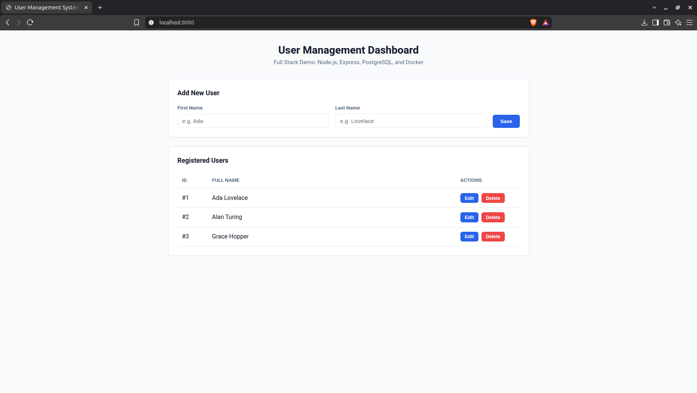
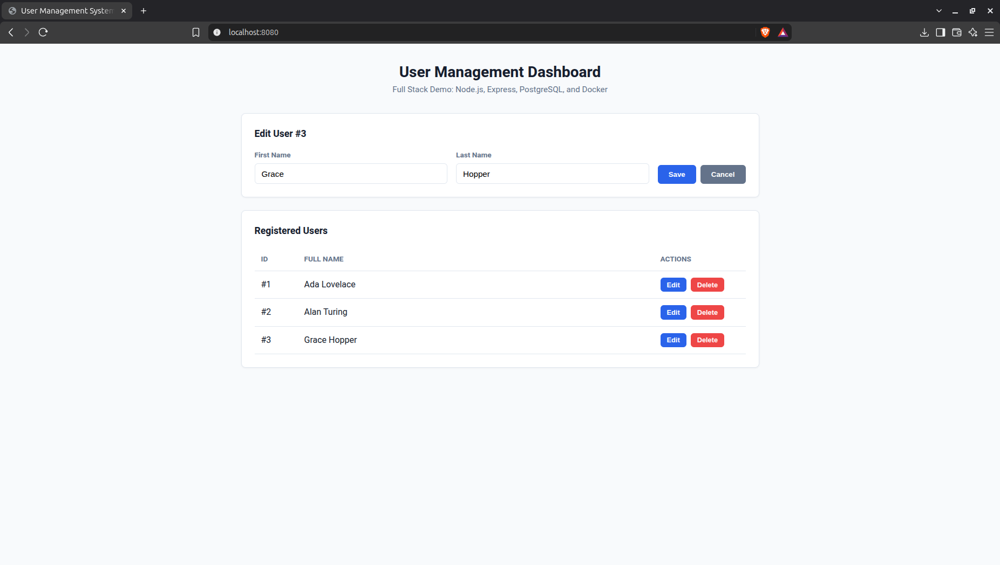

# User Management System (User CRUD)

[](https://nodejs.org/)
[](https://expressjs.com/)
[](https://www.postgresql.org/)
[](https://www.docker.com/)
[](LICENSE)

A containerized full-stack web application designed to provide user management operations through a RESTful API. The system features a responsive frontend dashboard, a backend powered by Node.js and Express, and a relational database managed with PostgreSQL.

## Academic Context

This repository originates from an academic assignment and was subsequently refactored to improve code organization, maintainability, and compliance with REST architectural conventions.

* **Institution:** Instituto Politécnico de Portalegre – Escola Superior de Tecnologia e Gestão (ESTG)
* **Course:** CTeSP – Tecnologias e Programação de Sistemas de Informação (TPSI)
* **Curricular Unit:** Tecnologias da Internet
* **Academic Year:** 2022/2023
* **Project:** Practical Project 1

## Technology Stack

| Component | Technology | Purpose |
| :--- | :--- | :--- |
| Backend | Node.js, Express.js | Server-side application and REST API |
| Database | PostgreSQL 15 | Relational data persistence |
| Database Driver | node-postgres (`pg`) | PostgreSQL connectivity and query execution |
| Frontend | HTML5, CSS3, Vanilla JavaScript | User interface and client-side interactions |
| Containerization | Docker | Application containerization |
| Orchestration | Docker Compose | Multi-container environment management |

### Frontend Details

* Semantic HTML5 structure.
* Modern CSS using Flexbox, CSS Grid, and custom properties.
* Vanilla JavaScript (ES6+).
* Fetch API for asynchronous HTTP communication.
* Dynamic DOM manipulation.

### Backend Details

* Express.js REST API.
* Modular routing and request handling.
* Asynchronous database operations using `async`/`await`.
* PostgreSQL connection pooling managed via `pg`.

### Infrastructure Details

* Docker-based containerized runtime.
* Docker Compose service orchestration.
* Persistent database volume storage (`pgdata`).
* Automated database schema and seed population through SQL init scripts.

## Features

* **Full CRUD Operations:** Create, retrieve, update, and delete user records.
* **RESTful API:** Standard HTTP methods, resource-oriented endpoints, and semantic HTTP status codes.
* **Asynchronous Communication:** Frontend-to-backend communication via native Fetch API and `async`/`await`.
* **Responsive Interface:** Modern dashboard optimized for both desktop and mobile viewports.
* **Relational Persistence:** PostgreSQL integration for structured relational data storage.
* **Containerized Environment:** Reliable and reproducible setup powered by Docker Compose.
* **Database Initialization:** Automated migration scripts with initial mock data.

## Application Preview



*Figure 1: Main dashboard interface displaying registered users and the creation form.*



*Figure 2: Form state during a user update operation.*

## System Architecture

The application follows a client-server architecture composed of three primary layers:

```text
                 Client Layer
           (HTML / CSS / JavaScript)
                       |
                       | HTTP Requests
                       | JSON Responses
                       |
                 Application Layer
                (Node.js / Express)
                       |
                       | Database Queries
                       | PostgreSQL Driver
                       |
                  Data Layer
                 (PostgreSQL)
```

### Component Responsibilities

| Component | Responsibility |
| :--- | :--- |
| Frontend | User interaction, data rendering, dynamic state updates, and API consumption. |
| Backend | HTTP request routing, input validation, business logic, and database operations. |
| Database | Persistent storage, transactional integrity, and relational data management. |

## Database Schema

The application uses PostgreSQL as its relational database management system. The initial schema is automatically executed on the first container startup from:

```text
docker/init.sql
```

The database structure and fields are defined as:

```sql
CREATE TABLE IF NOT EXISTS users (
    id SERIAL PRIMARY KEY,
    fname VARCHAR(100) NOT NULL,
    lname VARCHAR(100) NOT NULL,
    created_at TIMESTAMP WITH TIME ZONE DEFAULT CURRENT_TIMESTAMP
);
```

## Getting Started

### Prerequisites

Ensure the following tools are installed:

* Docker (v20+ recommended)
* Docker Compose

### Installation

1. Clone the repository:
   ```bash
   git clone https://github.com/joaoopmartins/user-management-crud.git
   ```

2. Navigate to the project directory:
   ```bash
   cd user-management-crud
   ```

3. Build and start the application containers:
   ```bash
   docker compose up --build -d
   ```

4. Verify container status:
   ```bash
   docker compose ps
   ```

### Accessing the Application

Once the containers are running, open your browser and navigate to:

```text
http://localhost:8080
```

### Stopping the Application

To stop and remove running containers:

```bash
docker compose down
```

To stop containers and delete the persistent database volumes:

```bash
docker compose down -v
```

Note: Removing volumes permanently deletes the database records stored in the volume.

## REST API Reference

The backend exposes a standardized RESTful API for user management operations.

### Available Endpoints

| Method | Endpoint | Description | Expected Status Codes |
| :--- | :--- | :--- | :--- |
| GET | `/api/users` | Retrieve all registered users | 200 OK |
| GET | `/api/users/:id` | Retrieve a specific user by ID | 200 OK, 404 Not Found |
| POST | `/api/users` | Create a new user record | 201 Created, 400 Bad Request |
| PUT | `/api/users/:id` | Update an existing user by ID | 200 OK, 400 Bad Request, 404 Not Found |
| DELETE | `/api/users/:id` | Delete a user record by ID | 204 No Content, 404 Not Found |

### Request Payload

The following JSON schema is required when creating (`POST`) or updating (`PUT`) a user:

```json
{
  "fname": "Grace",
  "lname": "Hopper"
}
```

### Example API Request

Create a new user with `cURL`:

```bash
curl -X POST http://localhost:8080/api/users \
  -H "Content-Type: application/json" \
  -d '{"fname":"Grace","lname":"Hopper"}'
```

## Project Structure

```text
├── docker/
│   ├── Dockerfile          # Node.js application container specification
│   └── init.sql            # PostgreSQL schema and initial seed records
├── public/
│   ├── css/
│   │   └── style.css       # External stylesheet with modern styling and variables
│   └── index.html          # Frontend dashboard and DOM controller scripts
├── src/
│   ├── config/
│   │   └── db.js           # PostgreSQL connection pool configuration
│   └── index.js            # Express server initialization and REST API routes
├── .dockerignore           # Excludes local files from Docker build context
├── .gitignore              # Specifies intentionally untracked files for Git
├── docker-compose.yml       # Multi-container service definition and orchestration
├── LICENSE                 # MIT License file
├── package.json            # Application dependencies and execution scripts
└── README.md               # Project documentation
```

## Testing

The REST API endpoints can be validated and inspected using tools such as:

* Postman
* cURL
* Browser Developer Tools (Network tab and Console)

Recommended test scenarios include full CRUD cycles, payload validation checks, handling non-existent IDs (404), and verifying server responses under network disconnects.

## Security Considerations

The following security standards are applied or recommended for this stack:

* **Parameterized SQL Queries:** Prevents SQL Injection vulnerabilities through query parameter bindings (`$1`, `$2`).
* **Input Validation:** Enforces non-empty values for required payload attributes.
* **Separation of Secrets:** Avoid hardcoding database credentials; rely on environment variables.
* **Semantic Status Reporting:** Returns predictable HTTP status codes without leaking server stack traces to clients.

## License

This project is licensed under the MIT License.